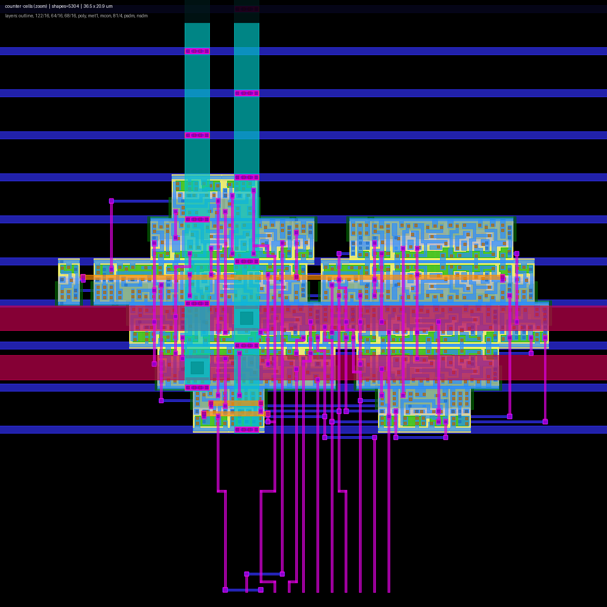
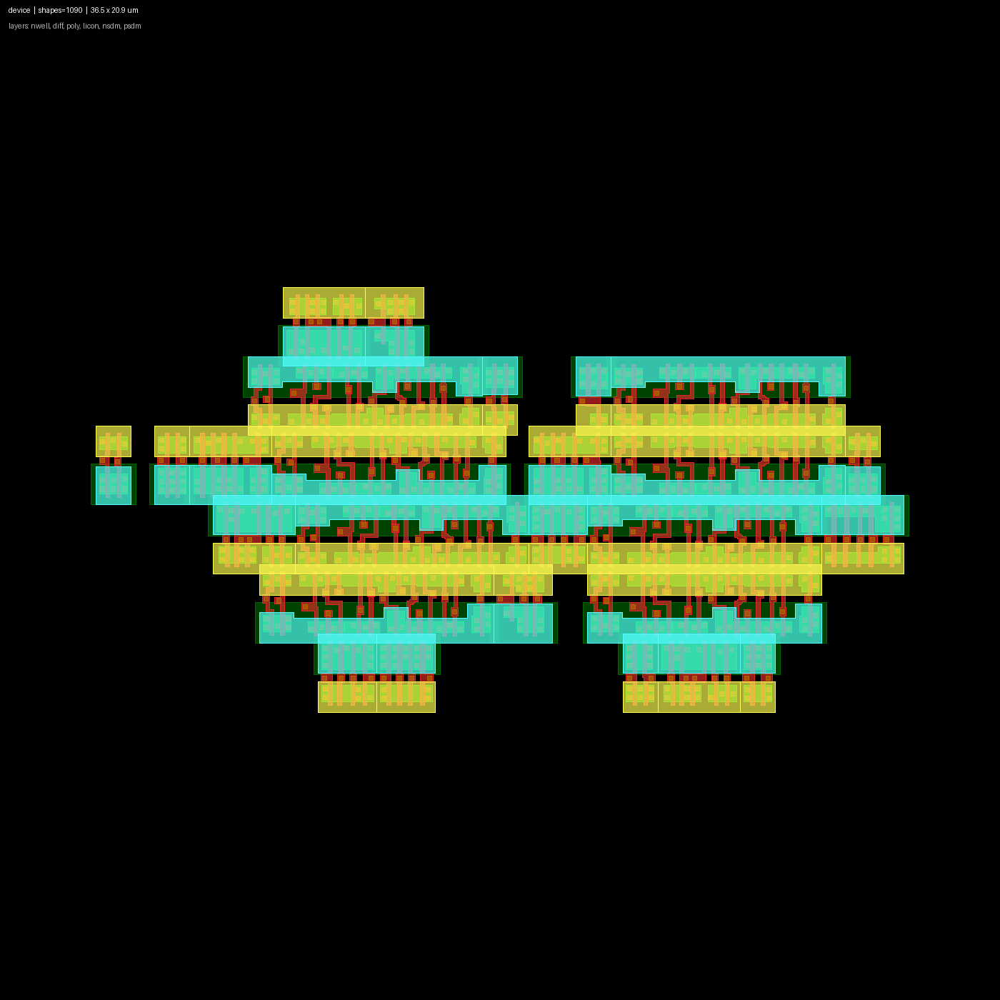
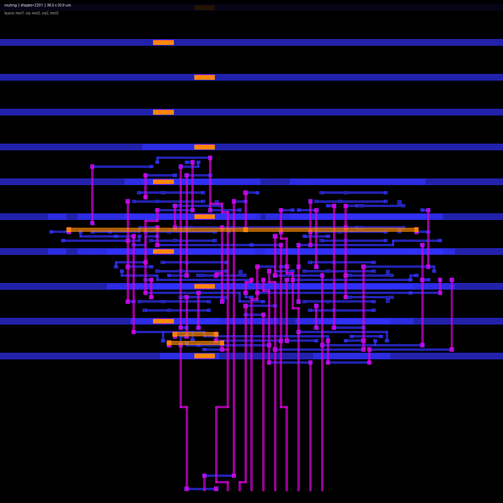
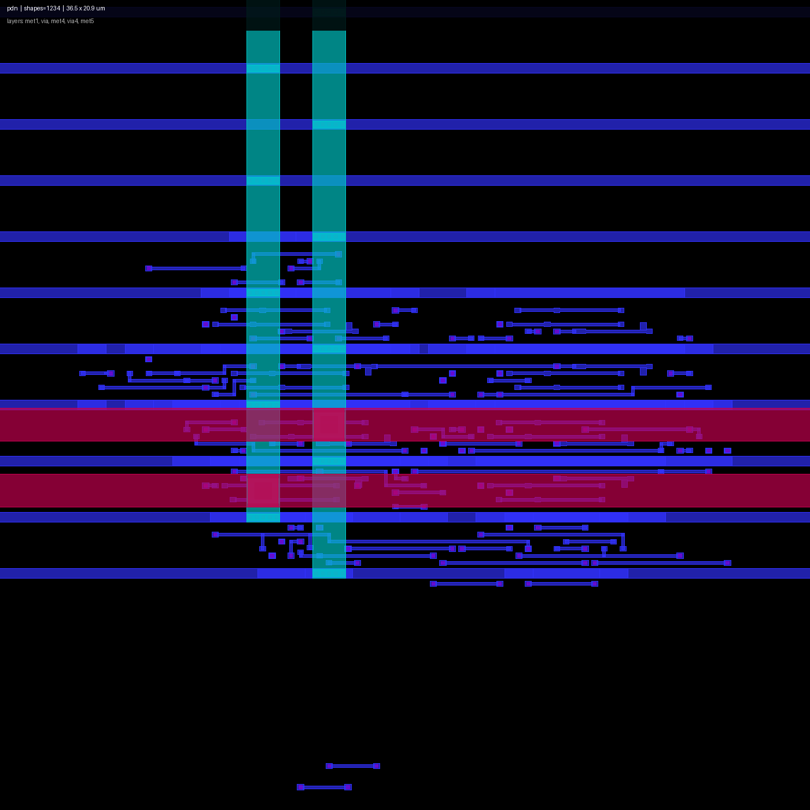

# openlane-lab — 用开源工具链把 RTL 走到 GDS

**不用 Docker，不用 OpenLane 黑盒。** 8-bit 计数器，SkyWater SKY130（`sky130_fd_sc_hd`），
在 WSL2 里一步步跑完综合 → 布图（含 PDN）→ 布局 → CTS → 布线 → STA → GDS → DRC → LVS，
每一步的命令、输入、输出、日志都留在仓库里。



| 指标 | 结果 |
|------|------|
| 工艺 / 单元库 | SKY130A / `sky130_fd_sc_hd`（volare 预编译版） |
| 综合面积 | 23 cells，299 µm²（8× `dfrtp_1`） |
| 布线 | 0 违例，信号线长 611 µm，via 194 |
| 电源 | met1 跟随轨 + met4/met5 主干，2 个电源网 **全部连通**（`check_power_grid`） |
| STA @10 MHz | WNS/TNS = 0（~1 GHz 开始违例） |
| GDS | 单 top cell `counter`，约 370 KB（met1–met5 + via） |
| DRC | **0 违例**（sky130A.lydrc，166 类规则） |
| LVS | **Netlists match uniquely**（26 devices / 32 nets） |
| 形式等价 | 9/9 proven |
| 变异测试 | 3/3 注入 bug 被 testbench 抓到 |

| 器件层（nwell/diff/poly/implant） | 绕线层（met1/met2/met3 + via） | 电源网络（met1 轨 + met4/met5 主干） |
|---|---|---|
|  |  |  |

## 1. 这个 lab 想解决什么

跑 OpenLane 很容易：一条命令，几十分钟，出一个 GDS。但中间发生了什么、哪一步错了，
全在 `runs/<design>/logs/` 的几万行里。

这里把 OpenLane 内部**拆成 10 个手写阶段**，每阶段一个脚本、一份产物、一条可核对的判据：

| # | 阶段 | 脚本 | 产物 | 判据 |
|---|------|------|------|------|
| 0 | 合并 LEF | `scripts/merge_lef.sh` | `runs/lef/*.lef` | 13 层 + 441 cells 能读入 |
| 1 | 综合 | `scripts/01_synth.sh` | `runs/01_synth/counter_synth.v` | 23 cells / 299 µm² |
| 2 | 布图 + PDN | `scripts/02_floorplan.sh` | `runs/02_floorplan/floorplan.def` | die 100×100，`SPECIALNETS=2` |
| 3 | 布局 | `scripts/03_place.sh` | `runs/03_place/place.def` | 0 重叠，HPWL 492.6 µm |
| 4 | CTS | `scripts/04_cts.sh` | `runs/04_cts/cts.def` | 插入 clock buffer，skew 可报告 |
| 5 | 布线 | `scripts/05_route.sh` | `runs/05_route/route.def` | violations = 0 |
| 6 | 签核（STA + PDN） | `scripts/06_signoff.sh` | `runs/06_signoff/sta.log`、`pdn_check.log` | WNS/TNS = 0；2/2 电源网连通 |
| 7 | GDS | `scripts/run_gds_drc.sh` | `runs/09_gds/counter.gds` | 单 top cell |
| 8 | DRC | 同上 | `runs/09_gds/drc.lyrdb` | `<item>` 数量 = 0 |
| 9 | LVS | `dump_cts_netlist.sh` + `lvs_extract.sh` + `run_lvs.sh` | `runs/10_lvs/lvs.out` | match uniquely |

## 2. 5 分钟复现

前置：WSL2 Ubuntu 24.04，工具按 [`docs/tools.md`](docs/tools.md) 装好。本机实测版本见那张表。

```bash
git clone <repo-url> && cd openlane-lab

# 0) 环境自检（缺什么会逐条告诉你）
bash scripts/check_env.sh

# 1) PDK（首次）
bash scripts/fetch_pdk.sh

# 2) 合并 LEF（每个 checkout 只需一次）
bash scripts/merge_lef.sh

# 3) 后端主流程：综合 → 布图 → 布局 → CTS → 布线 → STA
make all

# 4) 版图：GDS + DRC
bash scripts/run_gds_drc.sh

# 5) LVS 三连（顺序不能换）
bash scripts/dump_cts_netlist.sh    # post-CTS 网表 = 金标准
bash scripts/lvs_extract.sh         # Magic 从 DEF+LEF 提取
bash scripts/run_lvs.sh             # netgen 比对
```

跑完检查：`runs/09_gds/drc.lyrdb` 里 `<item>` 为 0；`runs/10_lvs/lvs.out` 里有
`Netlists match uniquely.`。

> `runs/` 里提交的是当时的真实日志。重跑会改动它们（日志里有绝对路径、GDS 头里有时间戳），
> 所以 `git status` 出现若干 `runs/` 变更是正常的，不是你没跑对。

## 3. 验证四件套（不需要 PDK）

```bash
bash scripts/run_sim.sh            # RTL 仿真 + 门级仿真，各 256+ 步
bash scripts/run_equiv.sh          # yosys 形式等价 RTL ≡ 网表
bash scripts/run_mutation.sh       # 注入 3 个 bug，testbench 必须抓到
bash scripts/run_timing_sweep.sh   # 时钟 100ns → 0.5ns 扫 WNS
```

前三个在 CI 里也跑（见 [`.github/workflows/smoke.yml`](.github/workflows/smoke.yml)），
所以 clone 下来不装 PDK 也能确认「仿真和等价是对的」。

## 4. 目录

```
.
├── rtl/counter.v              设计：8-bit 自由跑计数器（异步复位）
├── constraints/counter.sdc    10 MHz 约束
├── sim/                       testbench / 变异版本 / 10 个单元功能模型
├── scripts/
│   ├── env.sh                 唯一的环境入口（PDK 路径、PATH、合并 LEF）
│   ├── 01..06_*.sh            后端主流程
│   ├── run_sim/equiv/mutation/timing_sweep.sh
│   ├── run_gds_drc.sh         GDS + DRC
│   ├── dump_cts_netlist.sh / lvs_extract.sh / run_lvs.sh
│   ├── make_gds.py / make_golden.py / fix_ext_power.py
│   ├── dump_shapes.py / render_from_json.py
│   └── legacy/                没走通的路径（留作踩坑记录）
├── docs/                      流程笔记、验证证据链、工具安装、版图截图
├── runs/                      各阶段产物（.odb / .spice 不入库）
├── Makefile
└── HANDOFF.md                 完整交接文档（方法流 / 脚本手册 / 踩坑清单）
```

## 5. 已知局限（先声明，别当它是可流片设计）

1. **有 PDN，但没有 IR drop / EM。** 电源网格是 met1 跟随轨 + met4/met5 主干，
   `check_power_grid` 确认两个网全部连通；但 PDK 的 LEF 不带电阻参数，
   `analyze_power_grid` 会报 `PSM-0021 Resistance map contains invalid values`，
   所以压降/电迁移没算。另外 LVS 里的电源仍是 `fix_ext_power.py` 按名字短接**假定**的
   （Magic 的提取网表没有把电源轨并进顶层网）。
2. **LVS 是 LEF 抽象级。** Magic 用 LEF abstract 提取，比的是「实例类型 + 连接关系」，
   不是版图器件级。真实 LVS 要从 GDS 提晶体管，还要有完整的器件模型。
3. **STA 没有真实寄生。** 只有 `estimate_parasitics` 的布线估算，没有 SPEF / RC 提取，也没跑后仿。
   10 MHz 下 WNS=0 几乎没有信息量（setup slack 97.98 ns）。
4. **die 100×100，利用率 5%。** 教学用，面积/功耗数字不代表真实设计。真芯片会缩到 30×30 上下。
5. **单元功能模型是手写的**（`sim/sky130_hd_min.v`，10 个 cell）。它证明逻辑映射正确，
   不等于与 foundry 的 Verilog 模型 bit-exact。
6. **没有 tap cell / decap。** 防闩锁的 well tap 没插，这也是 IR drop 之外的空白。

## 6. 来源与致谢

**这个仓库不是 fork，是从零写的**（设计、脚本、文档都在本仓库演进）。
它站在下面这些东西上：

| 来源 | 用途 | 许可证 |
|------|------|--------|
| [google/skywater-pdk](https://github.com/google/skywater-pdk) | SKY130 工艺定义与单元库 | Apache-2.0 |
| [efabless/volare](https://github.com/efabless/volare) | 拉预编译 PDK（锁版本 hash） | Apache-2.0 |
| [The-OpenROAD-Project/OpenROAD](https://github.com/The-OpenROAD-Project/OpenROAD) | 布图/布局/CTS/布线/STA | Apache-2.0 |
| [RTimothyEdwards/magic](http://opencircuitdesign.com/magic/) | 版图提取（LVS 版图侧） | MIT 风格 |
| [YosysHQ/yosys](https://github.com/YosysHQ/yosys) | 综合、形式等价 | ISC |
| [KLayout](https://www.klayout.de/) | GDS 合成、DRC、几何导出 | GPL-3.0 |
| [netgen](http://opencircuitdesign.com/netgen/) | LVS 比对 | GPL-2.0 |
| [steveicarus/iverilog](https://github.com/steveicarus/iverilog) | RTL / 门级仿真 | GPL-2.0 |
| [efabless/openlane](https://github.com/efabless/openlane) | **仅流程概念参考**，未复用代码 | Apache-2.0 |

关于「从哪里来的」说清楚（本仓库没有别的上游）：

* `openlane-lab/` 是**从零建的**：接手时目录里没有 `.git`、没有上游 README/LICENSE/提交历史，
  设计、脚本、文档都是在这里写出来的 → 不是 fork，没有归属争议，本仓库的提交历史就是全部历史。
* 唯一"下载来的"东西是当时放在父目录的 `skywater-pdk-main.zip`——[google/skywater-pdk](https://github.com/google/skywater-pdk)
  `main` 分支的源码快照（Apache-2.0），本来想直接读 PDK 源码。它只有元数据和 `.gitmodules`，
  **没有进本仓库**；实际用的是 volare 装的预编译 PDK（`7519dfb04400f224f140749cda44ee7de6f5e095`）。
* 工具全部是系统安装（apt / Nix / pip），仓库里不含第三方二进制，也不需要 submodule。

## 7. 许可证

代码与文档：MIT（见 [`LICENSE`](LICENSE)）。
`runs/09_gds/counter.gds` 由 SKY130 标准单元（Apache-2.0）生成，按 Apache-2.0 分发。

---

**这是个学习工程，不是产品。** 拿它对照 OpenLane 的日志、理解每一步的输入输出，
比自己啃文档快得多。
